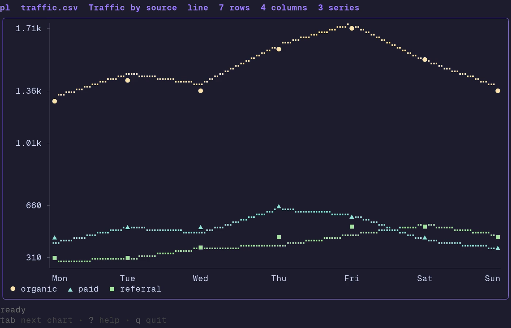

# pl

**Beautiful charts in your terminal.**

`pl` turns pipes, CSVs and SQLite queries into line, bar, pie and donut charts in milliseconds.
It is a single static Go binary with an optional Bubble Tea TUI, a local parsed-dataset cache and no network access.

[Website](https://sazardev.github.io/plot/) · [Playground](https://sazardev.github.io/plot/#playground) · [Usage guide](https://sazardev.github.io/plot/#docs) · [Issues](https://github.com/sazardev/plot/issues)



## Install

Requires Go 1.26+.

```sh
go install github.com/sazardev/plot/cmd/pl@latest
```

Make sure `$(go env GOPATH)/bin` is on your `PATH`. Or build from source:

```sh
git clone https://github.com/sazardev/plot.git
cd plot
CGO_ENABLED=0 go build -o pl ./cmd/pl
```

## Quick start

```sh
# stdin
printf 'day,signups\nMon,3\nTue,5\nWed,4\n' | pl

# a CSV file
pl sales.csv

# a PostgreSQL result
psql --csv -c "select day, signups from metrics order by day" | pl

# SQLite directly
pl --db metrics.db --query 'select day, signups from metrics order by day'

# save the same chart as an image or PDF
pl sales.csv --export chart.png
pl sales.csv --export chart.pdf

# interactive TUI; press e to export
pl --tui sales.csv
```

The default is a bar chart for one categorical series of 30 rows or fewer; otherwise a line chart.
Use `--type bar|line|pie|donut` to choose explicitly.

## What it does

- Line charts with braille subcells, up to 8 series, markers and gaps for nulls.
- Bar charts with positive and negative values, sampled labels and stable guards.
- Pie and donut charts with largest-remainder percentages and a legend.
- Delimiter and header detection, multiple files, column selection, renames, sorting and filtering.
- Read-only SQLite input with query timeouts and verbatim driver errors.
- A TUI with chart cycling, help, resize handling, reduced motion and terminal restore.
- Terminal ANSI colors, `NO_COLOR`, `TERM=dumb`, ASCII glyphs and non-TTY output.
- Localized messages and locale-aware number formatting.
- A disposable SQLite cache with content-addressed keys, TTL, LRU eviction and user-only permissions.
- Strict TOML configuration with flags > environment > config > default precedence.
- Native PNG/JPG/PDF export from the same terminal frame, inheriting the terminal palette and system font: `--export chart.png` or `e` in the TUI. Override with `PL_EXPORT_FONT` and `PL_EXPORT_FONT_SIZE`.
- A browser playground for CSV, TSV, Markdown tables, JSON, SQL dumps, Excel and SQLite, with saved history and a local data agent.

## Try the example workspace

The repository includes a self-contained playground with CSV, SQLite, config, delimiter, edge-case and browser-format fixtures:

```sh
./examples/run.sh          # interactive menu
./examples/run.sh sqlite   # or run one scenario directly
./examples/run.sh tui
```

See [examples/README.md](examples/README.md) for every scenario and file.

## Documentation

The full usage guide, flag reference, config example, TUI keys and exit codes live on the website:

**[sazardev.github.io/plot](https://sazardev.github.io/plot/#docs)**

The design and engineering notes are in [SPEC.md](SPEC.md), [STACK.md](STACK.md), [DESIGN.md](DESIGN.md) and [AGENTS.md](AGENTS.md).

## Development

```sh
go test ./...
go test -race ./...
go vet ./...
golangci-lint run
gofmt -l -w .
CGO_ENABLED=0 go build -o pl ./cmd/pl
```

Render goldens: `go test ./internal/render -update`
TUI goldens: `go test ./internal/ui -update-tui`

## License

MIT. See [LICENSE](LICENSE).
